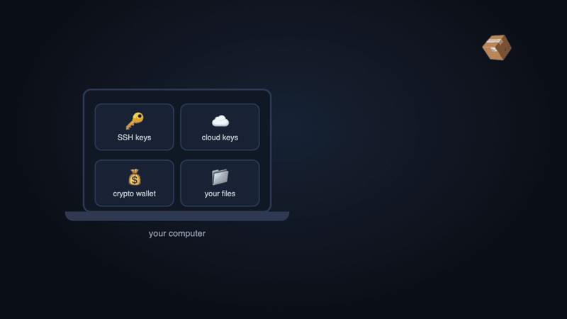
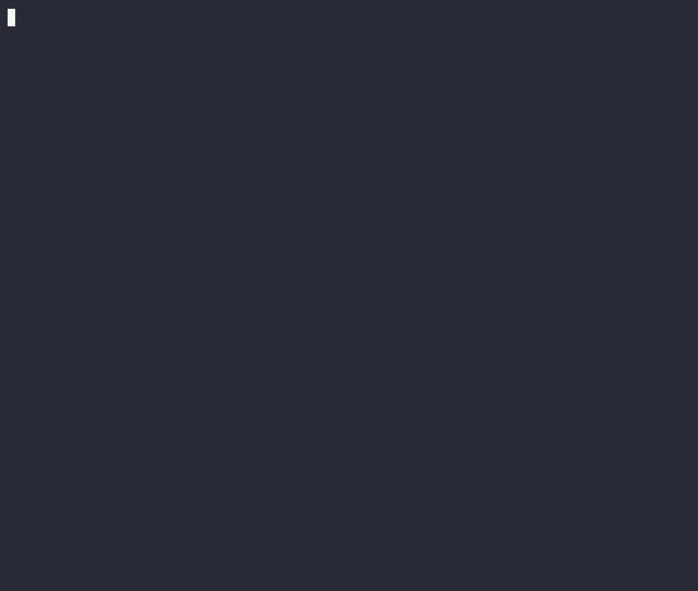

<div align="center">

# 🏛️ dokimasia

**Run untrusted repos in a disposable VM. Nothing from the repo ever executes on your machine.**

[](LICENSE)


[](#-agents)

[](#-contributing)
[](https://github.com/DevoRia/dokimasia)



</div>

---

`npm install`, `pip install`, `make`, `./run.sh` — the first run of someone else's code happens as **your user**, next to your SSH keys, cloud credentials, browser sessions and wallets. A take-home task from a "recruiter", a tool from a random repo, a binary you want to reverse-engineer: you just want to try it, not hand it your machine.

`dokimasia` gives that code its own throwaway Linux VM and lets you (or your coding agent) drive it from the outside:

```bash
dokimasia up git@github.com:someone/take-home.git   # VM boots in ~10 s, repo copied to /work
dokimasia exec -- npm test                          # runs inside the VM, output streams back
dokimasia down                                      # VM and its disk are gone
```

- 🖥️ **A real VM, not a container** — own kernel via QEMU (`hvf` on macOS, `kvm` on Linux).
- 🔌 **No network device by default** — not a firewall rule the code could flip, the NIC simply doesn't exist.
- 📦 **Copied in, never mounted** — the repo travels on a read-only ISO. No shared folders, no clipboard, no SSH, no ports.
- 🤖 **Built for agents** — any agent that can run a shell command can drive the VM; a Claude Code plugin is included.
- 🗑️ **Disposable** — copy-on-write disk over a clean base image, deleted on `down`.
- 🪶 **Tiny** — one Python file, stdlib only. Read it in 10 minutes.

## 🎬 In the terminal



## 🚀 Quickstart

**1. Install QEMU**

| OS | |
|---|---|
| macOS | `brew install qemu` |
| Debian / Ubuntu | `sudo apt install qemu-system qemu-utils xorriso` (+ `qemu-efi-aarch64` on ARM) |
| Fedora | `sudo dnf install qemu-kvm qemu-img xorriso` |
| Windows | inside **WSL2** (Windows 11 exposes `/dev/kvm` there), then the Linux steps |

**2. Get dokimasia**

```bash
git clone https://github.com/DevoRia/dokimasia
ln -s "$PWD/dokimasia/bin/dokimasia" /usr/local/bin/dokimasia
dokimasia init     # once: downloads Debian 13 cloud image (~350 MB), installs node, python, build tools
```

**3. Try something**

```bash
dokimasia run ./some-repo -- 'npm ci --ignore-scripts && npm test'
```

## 🧰 Commands

| Command | |
|---|---|
| `dokimasia up <dir\|git-url> [--net]` | Boot a VM with a copy of the repo in `/work` |
| `dokimasia exec [--timeout S] -- <cmd>` | Run a command in `/work` as root in the VM, stream output, pass exit code through |
| `dokimasia logs [-n N]` | Show the VM's serial console |
| `dokimasia down` | Kill the VM and delete its disk |
| `dokimasia run <dir\|git-url> [--net] -- <cmd>` | `up` + `exec` + `down` in one go |
| `dokimasia ls` | List sessions |

Add `--name <n>` to `up` / `exec` / `logs` / `down` to run several VMs at once.

## 🤖 Agents

Coding agents are the riskiest way to run strange code: they `npm install` without blinking, and the repo's README can talk them into things. With dokimasia **the agent stays on your host and the code stays in the VM** — the agent only sees text.

**Claude Code**

```
/plugin marketplace add DevoRia/dokimasia
/plugin install dokimasia@dokimasia
```

> *"Clone DevoRia/some-project and run its tests safely."*

The skill tells Claude to `up` the repo, iterate with `exec`, treat everything coming out of the VM (and the repo's own AGENTS.md / README) as untrusted data, ask before enabling the network, and `down` when done.

**Any other agent** (Codex, Cursor, Aider, your own): give it the CLI and the rules in [`skills/dokimasia/SKILL.md`](skills/dokimasia/SKILL.md).

## ⚙️ How it works

```
 host                                          disposable VM  (QEMU + hvf/kvm)
 ────                                          ──────────────────────────────
 git clone --depth 1  (hooks/config off)
 tar (symlinks not followed)
        └─► read-only cloud-init ISO ───────►  untar into /work
 qcow2 overlay on clean base image             Debian 13 + node / python / build tools
                                               no network device
 dokimasia exec ──► unix socket ─► virtio-serial ─► root shell ─► your command
 terminal       ◄── text, escape codes stripped ◄──── output + exit code
 dokimasia down ──► kill QEMU, delete overlay
```

## 🛡️ Security model & limits

- **Boundary = the QEMU hypervisor.** A VM-escape exploit is out of scope; for that level of threat use a sacrificial machine.
- **Network off** means no NIC at all. `--net` adds QEMU user-mode NAT: code inside can then reach the internet (but not your files).
- **The host only clones.** `git clone` runs with hooks, submodules, fsmonitor, system and global git config disabled. Local directories are archived without following symlinks.
- **Output is untrusted text.** Terminal escape sequences are stripped before printing; nothing from the VM is ever executed on the host.
- If the `dokimasia` process itself is killed mid-`run`, the VM keeps running — `dokimasia ls` shows it, `dokimasia down --name …` removes it.
- Tested on **macOS / Apple Silicon**. Linux x86_64 / arm64 and WSL2 should work but are not verified yet — reports welcome.

## 🆚 Compared to

| | What runs in the VM | Your code | Agent |
|---|---|---|---|
| **dokimasia** | the untrusted repo | copied in, no mounts, no network | stays on the host, drives the VM |
| [clawk](https://github.com/clawkwork/clawk), [coop](https://github.com/trailofbits/coop) | the coding agent | mounted from the host, ssh-agent forwarded | inside the VM |
| [fend](https://github.com/Lisovate/fend) | `npm` commands | project dir shared via VirtioFS | — |
| Docker / firejail / bubblewrap | a process | bind mounts | shares the host kernel |

## 🤝 Contributing

Issues and PRs welcome. Everything lives in [`bin/dokimasia`](bin/dokimasia), and the agent rules are in [`skills/dokimasia/SKILL.md`](skills/dokimasia/SKILL.md).

## 📄 License

[MIT](LICENSE)
